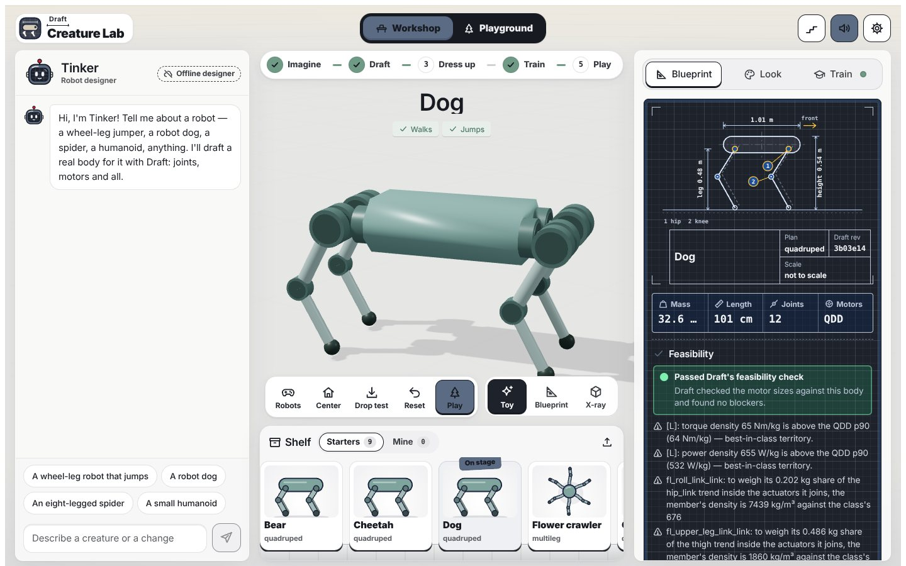
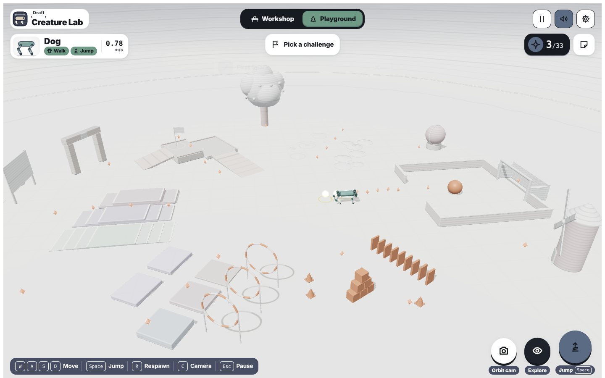

# Draft Creature Lab

Describe a robot in plain words and get a real one. **Tinker**, an AI designer, turns your idea into a design spec. **[Draft](https://github.com/davidhnguyen2000/draft)** (Nguyen, Coelho & Kim, MIT) generates a physically consistent body from that spec: links, joints, meshes, masses, and actuators sized from real motor trends. Draft rejects designs that cannot work. You can then train the robot to walk and jump on your own CPU, change its look, and drive it like a game character through a white-box park with terrain lanes and props. You can also give a vision model a goal and let it steer.

Everything runs on one computer. MuJoCo physics and the learned controllers run in the browser through WebAssembly, and Draft and the trainer run on the CPU. You don't need a GPU or an account.




## Quick start (macOS or Linux)

You need Git, Python 3.10–3.13, Node.js 22.12+ (or 20.19+) and a browser with WebGL2 (Chrome, Safari, Edge or Firefox). On a Mac you can install Python and Node with `brew install python@3.12 node`.

```bash
git clone -b v2-creature-park https://github.com/rbynwang/Robo_draft_lab.git draft-creature-lab
cd draft-creature-lab
./setup.sh --no-training     # about 5 minutes the first time
./start.sh
```

Open **http://127.0.0.1:18381/**. `Ctrl+C` in the terminal stops everything. To use other ports, run `./start.sh --port 18581 --api-port 18582 --ai-port 18583`.

`setup.sh` does the following:
- Clones Draft at the pinned commit `3b03e144` into `.deps/draft`.
- Creates `.venv` with pinned CPU packages (MuJoCo 3.8.0, NumPy, SciPy, trimesh).
- Runs `npm ci`.
- Prepares the bundled bodies.

Without `--no-training`, setup also creates `.venv-train` (CPU PyTorch + MuJoCo 3.11) for in-app training. You can add it later with `./training/setup-train-env.sh`. `start.sh` builds the web app and starts three local services: the web app (18381), the Draft API (18382) and the AI service (18383). All three listen only on `127.0.0.1`.

## The flow: Imagine → Draft → Dress up → Train → Play

1. **Imagine.** Chat with Tinker, for example *"an eight-legged spider that can cross gaps"*, *"make the legs longer"* or *"paint it olive"*. Tinker proposes a design spec (body plan, size, leg count, motor class) and a look.
2. **Draft.** The lab sends the spec to Draft. Draft builds the MuJoCo model and runs its feasibility gate. If a design fails, it comes back with hints, and Tinker revises it. The **Blueprint** tab shows dimensions, mass, joints, motor class and the full feasibility report.
3. **Dress up.** The **Look** tab changes palettes and finishes and exports a print kit. Looks are cosmetic: the physics body stays the same.
4. **Train.** The **Train** tab runs CPU PPO for a walk policy, and a jump policy when the body can jump. Each policy is exported to ONNX and must pass evaluation gates before the playground uses it: standing, forward and backward speed tracking, turns, start–stop, push and drop recovery, and bumpy ground.
5. **Play.** Drive the robot in the playground. Collect sparks, push the ball into the goal, knock over dominoes, jump through hoops, or run the Terrain Lab lanes.

### Controls

| Action | Keyboard | Gamepad | Touch |
| --- | --- | --- | --- |
| Move / turn | W A S D or arrow keys | left stick | on-screen joystick |
| Jump (robots with a jump skill) | Space | A / Cross | Jump button |
| Respawn | R | B / Circle | — |
| Camera | C | Y / Triangle | Orbit cam |
| Pause | Esc | Start | Pause button |

## Robots included

| Robot | Body (generated by Draft) | Skills | Notes |
| --- | --- | --- | --- |
| **Dog** | quadruped, 12 joints, 32.6 kg, 1.01 m long, 0.48 m legs | walk, jump | trained with the bundled CPU trainer |
| **Octo** | eight legs, 24 joints, 13.1 kg, 1.09 m span, 0.42 m legs | walk | 30 M-step walk policy trained on a Mac mini CPU (4 cores) |
| **Flower crawler** (spider) | six legs, 18 joints | walk | the original lab's policy |
| **Cheetah** | quadruped | walk | the original lab's policy |
| **Rollo** (wheel-leg), **Bipo** (humanoid) | on the roster as design targets | — | bodies and policies are not finished yet |

You can design new bodies with Tinker at any time. Each new body has to be trained before you can drive it.

## Terrain Lab: how each body meets the ground

The park has a Terrain Lab with parallel lanes: a 5 m flat sprint, 2–6 cm rubble, 6/12/18 cm steps, 0.20/0.35/0.50 m gaps over a pit, and 12°/20° ramps. You can drive the lanes yourself. `qa/terrain-trials.mjs` also runs every robot through every grade headlessly, using real MuJoCo and ONNX:
- The forward command is fixed at 70 % of the robot's top speed.
- Heading-hold keeps the robot on the lane.
- An automatic jump at gap and step edges is used only by robots that have a validated jump skill.

The playground shows these results, measured with the bundled policies:

| Grade | Dog | Octo | Flower | Cheetah |
| --- | --- | --- | --- | --- |
| Flat sprint 5 m | fell (drifted off the lane) | **pass** 9.6 s | **pass** 22.5 s | **pass** 16.8 s |
| Rubble 2–6 cm | **pass** | stalled | **pass** | fell |
| Step 6 cm | fell | **pass** | stalled | **pass** |
| Step 12 cm | fell | stalled | stalled | **pass** |
| Step 18 cm | stalled | stalled | stalled | fell |
| Gap 0.20 m | fell | stalled | stalled | stalled |
| Gap 0.35 m / 0.50 m | fell / fell | fell / fell | fell / fell | stalled / stalled |
| Ramp 12° | **pass** | **pass** | stalled | **pass** |
| Ramp 20° | fell | fell | stalled | **pass** |

The structure explains most of the table. The numbers below come from each robot's `body.json`.

- **Octo** walks a ripple gait that keeps six of its eight feet down. Its stability margin is 0.48 m standing and still 0.36 m mid-stride, and its centre of mass is low (0.27 m). That makes it the fastest on the flat and lets it take the 6 cm step and 12° ramp without falling. Its limit is strength: 0.9 N·m of joint torque per kilogram of body, against the Dog's 2.2. So it stalls at the 12 cm step, and its 0.42 m legs and 0.22 m belly clearance cannot bridge a gap. Each foot is in the air only a quarter of the cycle, which probably explains why the feet catch on rubble.
- **Dog** trots on two feet at a time, so its stability margin mid-stride is about zero. Its centre of mass is high (0.43 m), so it balances dynamically. That works on rubble and the 12° ramp, but a 6–12 cm riser trips a front leg, and 20° tips it over. It has the strongest joints (vertical force 8× body weight) and a validated jump. That jump is a hop in place, though: about 10 cm high and 0.2 s in the air, which at walking speed carries it well short of 0.20 m. Crossing gaps needs a running-jump skill trained with forward speed, not a new body.
- **Flower** keeps several of its six feet on the ground at once, which is why it crosses rubble cleanly where Octo stalls. It is slow and low, so it stalls at the first 6 cm step and on the 12° ramp.
- **Cheetah** is the best climber of the four (12 cm steps, 20° ramp). It falls on rubble and stops at every gap edge because it has no jump skill.

All four policies were trained on flat ground, so the table shows how each body copes with terrain it has never seen. The next steps are terrain curricula (steps and rubble), a running jump for the Dog, and a stronger motor class for Octo. Rollo and Bipo are left out because their bodies are not finished.

## AI: Tinker and Explore

- **Offline by default.** With no model configured, Tinker uses a rule-based designer that still produces valid Draft specs.
- **Local model.** `./scripts/setup-local-ai.sh` installs [Ollama](https://ollama.com) and picks a vision model that fits your RAM: `qwen3-vl:2b-instruct` under 12 GB, `qwen3.5:4b` for 12–23 GB, `qwen3.5:9b` for 24 GB or more.
- **Cloud model.** Export a key in your shell or put it in the git-ignored `ai-service/.env.local`. Supported keys are `DASHSCOPE_API_KEY` (Qwen), `ZHIPUAI_API_KEY` (GLM), `GEMINI_API_KEY` and `OPENAI_API_KEY`. Providers and models are listed in [ai-service/README.md](ai-service/README.md).
- **Explore.** In the playground, open **Explore** and type a goal, for example *"Go to the red ball"* or *"reach the yellow flag beyond the gap"*. At each step the robot's camera image goes to the vision model, which picks one bounded move: walk, turn, or jump if the robot has a validated jump. The learned gait carries out the move. The world, not the model, decides when the goal is reached, and any manual input takes over.

## Training from the command line

```bash
./training/setup-train-env.sh                     # once
.venv-train/bin/python -m creature_gym.train --body creatures/<bodyId> --skill walk --budget quick --out creatures/<bodyId>/policies/walk
```

See [training/README.md](training/README.md) for budgets, resuming long runs in chunks, evaluation and measured speeds.

## Checks

```bash
node qa/terrain-trials.mjs --pilot legacy-cheetah --bundle /creatures/quadruped-329a735927fa8b37 --map /creatures=creatures
(cd ai-service && ../.venv/bin/python -m unittest discover -s tests)
.venv/bin/python -m unittest discover -s draft-service -p 'test_*.py'
(cd play && npm run build)
```

The terrain trials run real MuJoCo WASM and ONNX Runtime headlessly, using the same playground modules as the browser.

## Project layout

- `play/`: the web app. React UI kit (`src/ui`), workshop (`src/draft-lab.js`), playground engine (`src/world`), looks (`src/appearance`) and the white-box scene style (`src/app/whitebox.js`).
- `draft-service/`: local API for Draft generation (`/api/design`), body files, training jobs and policy bundles.
- `ai-service/`: Tinker chat, design critique and vision decisions, with offline, Ollama and cloud providers.
- `training/creature_gym/`: CPU PPO trainer, ONNX export and evaluation gates.
- `creatures/`: generated bodies and trained policy bundles.
- `contracts/`: JSON schemas and API contracts shared by the services.
- `docs/v2/`: design plan, roster and the Terrain Lab protocol.
- `robots/flower/`, `qa/`, `vlm-service/`: the original lab's Flower body, checks and legacy vision adapter.

## Limits

This is a simulation. No hardware is involved, and the policies have not been tested on a real robot. Policies are trained on flat ground, so lanes beyond a body's ability fail; the Terrain Lab is there to show that. Vision Explore is experimental. Rollo and Bipo are not finished.

## Credits and license

Original application code and locally authored assets are MIT licensed. Bodies are generated with Draft (MIT), pinned to commit `3b03e144`. Physics runs on MuJoCo, inference on ONNX Runtime and rendering on Three.js. Notices for these and all other third-party components are in [THIRD_PARTY_NOTICES.md](THIRD_PARTY_NOTICES.md). No Pollen Robotics or Microduck hardware assets or policies are included.
